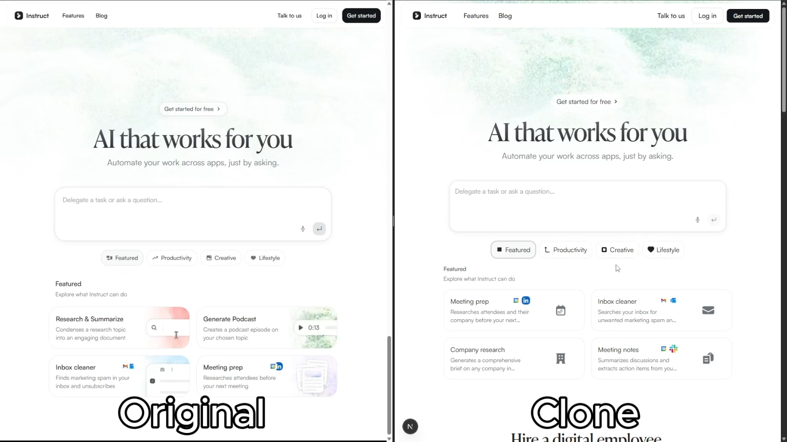

# Samsy Clone

A local, interactive reconstruction of `https://samsy.ninja/` built with Next.js 16, React 19, Three.js, and local copies of the publicly served runtime assets.

## Implemented

- Explorable cybercity reconstructed from the original source-extracted 35-instance GLB kit layout, with exact per-instance position/rotation/scale data, local VRM avatar, camera-relative WASD movement, Shift sprint, double-jump, gait animation, single-click free mouse-look with Escape release, mouse-wheel zoom, animated billboard/video materials, source-derived world bounds, ramp-aware ground movement, bloom, long-range fog, and a wet reflective floor with dark non-emissive grid seams.
- `/works` with all 25 extracted projects, local project videos, keyboard/wheel navigation, external visit links, and information panels.
- `/about` with the bilingual content, original contact links, credits, and reconstructed animated tunnel background.
- Loading/tutorial flow, sound toggle, reduced-motion behavior, direct-route refresh support, and a no-WebGL fallback.
- Target-specific research, asset manifests, interaction maps, scene/component specifications, deterministic screenshots, visual comparisons, QA evidence, and limitations under `docs/research/` and `docs/design-references/`.

## Explore controls

- `W A S D` or arrow keys — move relative to the current camera direction.
- Click the 3D view once — capture the mouse, then look freely without holding a button.
- `Escape` — release the mouse so menus can be clicked.
- Mouse wheel — zoom from a close character view to a wide city view.
- Hold `Shift` — sprint.
- `Space` — jump; press again in the air for a double-jump.

The Explore controller uses the verified original spawn, 1.65 avatar scale, 60° desktop FOV, eight-unit orbit camera, and 700–800-unit fog range. The playable limits come from the original 35-instance kit world rather than the former miniature single-GLB scene.

## Run

```bash
npm install
npm run dev
```

Production standalone build:

```bash
npm run build
npm start
```

Set `PORT` and `HOSTNAME` through environment variables when needed. `npm run build` automatically copies `public/` and `.next/static/` into the standalone output.

## Verification

- `npm run check` passes.
- The optimized standalone server passes **42/42 browser checks** in `scripts/qa-samsy.mjs`, including the wet floor with non-emissive seams, single-click free mouse-look, Escape release, the 35-instance architecture, original avatar/camera scale, camera-relative movement, Shift sprint, measured jump height, double-jump, advancing billboard video time, wheel zoom, source-derived fog, and full original world bounds.
- Runtime assets load locally with no failed requests or browser console errors.
- Final visual checkpoints are stored in `docs/design-references/final/`.
- The canonical production traversal captured **1,133 compositor frames** with `everyNthFrame: 1`, pointer-lock mouse-look, and zero console/request failures.
- All **1,951 original compositor frames** are phase-normalized and paired in `docs/research/samsy/FRAME_COMPARISON_V3.md` and `docs/research/samsy/frame-comparison-v3.json`.
- Full source extraction and all-angle original/clone recon are documented in `docs/research/samsy/recon-v2/FULL_RECON.md`.

This reconstruction is for local development, study, and authorized use. SMSY branding, copy, media, models, and other original assets remain the property of their respective owners.

---

# AI Website Cloner Template

<a href="https://github.com/JCodesMore/ai-website-cloner-template/blob/master/LICENSE"></a> <a href="https://github.com/JCodesMore/ai-website-cloner-template/stargazers"></a> <a href="https://discord.gg/hrTSX5yTpB"></a> 

A reusable template for reverse-engineering any website into a clean, modern Next.js codebase using AI coding agents. 

**Recommended: [Claude Code](https://docs.anthropic.com/en/docs/claude-code) with Opus 4.8 for best results** — but works with a variety of AI coding agents.

Point it at a URL, run `/clone-website`, and your AI agent will inspect the site, extract design tokens and assets, write component specs, and dispatch parallel builders to reconstruct every section. Interactive 3D targets activate a dedicated WebGL/WebGPU track for scene detection, model/texture/shader capture, camera and timeline mapping, interaction replay, deterministic visual checkpoints, performance checks, and mobile/fallback reconstruction.

## Demo

[](https://youtu.be/O669pVZ_qr0)

> Click the image above to watch the full demo on YouTube.

## Quick Start

> **Important:** Start by making your own copy with GitHub's **Use this template** button. Do not clone this template repository directly for your website project, and do not open pull requests here with your generated website.

1. **Create your own repository from this template**

   On the GitHub page for this project, click **Use this template**, then click **Create a new repository**.

   Give your new repository a name, choose whether it should be public or private, then click **Create repository**. If GitHub shows an **Include all branches** option, you can leave it off.

   This gives you your own separate project to work in, so your website changes stay in your account instead of coming back to the main template.

2. **Open your new repository on your computer**

   After GitHub creates your copy, open that new repository. Click **Code** and open or clone your new repository with your preferred coding tool.

   If you use the terminal, the command will look like this:

   ```bash
   git clone https://github.com/YOUR-USERNAME/YOUR-NEW-REPOSITORY.git
   cd YOUR-NEW-REPOSITORY
   ```

3. **Install dependencies**
   ```bash
   npm install
   ```
4. **Start your AI agent** — Claude Code recommended:
   ```bash
   claude --chrome
   ```
5. **Run the skill**:
   ```
   /clone-website <target-url1> [<target-url2> ...]
   ```
6. **Customize** (optional) — after the base clone is built, modify as needed

> Using a different agent? Open `AGENTS.md` for project instructions — most agents pick it up automatically.

## Supported Platforms

| Agent                                                         | Status                     |
| ------------------------------------------------------------- | -------------------------- |
| [Claude Code](https://docs.anthropic.com/en/docs/claude-code) | **Recommended** — Opus 4.8 |
| [Codex CLI](https://github.com/openai/codex)                  | Supported                  |
| [OpenCode](https://opencode.ai/)                              | Supported                  |
| [GitHub Copilot](https://github.com/features/copilot)         | Supported                  |
| [Cursor](https://cursor.com/)                                 | Supported                  |
| [Windsurf](https://codeium.com/windsurf)                      | Supported                  |
| [Gemini CLI](https://github.com/google-gemini/gemini-cli)     | Supported                  |
| [Cline](https://github.com/cline/cline)                       | Supported                  |
| [Roo Code](https://github.com/RooCodeInc/Roo-Code)            | Supported                  |
| [Continue](https://continue.dev/)                             | Supported                  |
| [Amazon Q](https://aws.amazon.com/q/developer/)               | Supported                  |
| [Augment Code](https://www.augmentcode.com/)                  | Supported                  |
| [Aider](https://aider.chat/)                                  | Supported                  |

## Prerequisites

- [Node.js](https://nodejs.org/) 24+
- An AI coding agent (see [Supported Platforms](#supported-platforms))

## Tech Stack

- **Next.js 16** — App Router, React 19, TypeScript strict
- **shadcn/ui** — Radix primitives + Tailwind CSS v4
- **Tailwind CSS v4** — oklch design tokens
- **Lucide React** — default icons (replaced by extracted SVGs during cloning)

## How It Works

The `/clone-website` skill runs a multi-phase pipeline:

1. **Reconnaissance** — screenshots, design token extraction, interaction sweep (scroll, click, hover, responsive), plus early canvas/WebGL/WebGPU detection
2. **Foundation** — updates fonts, colors, globals, downloads all assets; 3D targets also build a model/texture/environment/shader manifest and choose the smallest evidence-backed rendering stack
3. **Component + Scene Specs** — writes detailed DOM specs (`docs/research/components/`) and, when needed, 3D scene specs (`docs/research/scenes/`) covering camera, scene graph, materials, lighting, post-processing, animation, input mapping, responsive composition, lifecycle, and fallbacks
4. **Parallel Build** — dispatches builder agents in git worktrees, split by section and by focused 3D responsibility when necessary
5. **Assembly & QA** — merges worktrees, wires up the page, replays deterministic visual/interaction checkpoints, runs visual diffs, and records performance and lifecycle results

Each builder agent receives the full component specification inline — exact `getComputedStyle()` values, interaction models, multi-state content, responsive breakpoints, and asset paths. No guessing.

## Use Cases

- **Platform migration** — rebuild a site you own from WordPress/Webflow/Squarespace into a modern Next.js codebase
- **Lost source code** — your site is live but the repo is gone, the developer left, or the stack is legacy. Get the code back in a modern format
- **Learning** — deconstruct how production sites achieve specific layouts, animations, and responsive behavior by working with real code

## Not Intended For

- **Phishing or impersonation** — this project must not be used for deceptive purposes, impersonation, or any activity that breaks the law.
- **Passing off someone's design as your own** — logos, brand assets, and original copy belong to their owners.
- **Violating terms of service** — some sites explicitly prohibit scraping or reproduction. Check first.

## Project Structure

```
src/
  app/              # Next.js routes
  components/       # React components
    ui/             # shadcn/ui primitives
    icons.tsx       # Extracted SVG icons
  lib/utils.ts      # cn() utility
  types/            # TypeScript interfaces
  hooks/            # Custom React hooks
public/
  images/           # Downloaded images from target
  videos/           # Downloaded videos from target
  models/           # 3D models and geometry buffers
  textures/         # Material and compressed textures
  environments/     # HDR/EXR/cubemap environments
  shaders/          # Extracted or reconstructed shader sources
  seo/              # Favicons, OG images
docs/
  research/         # Extraction output, behavior evidence, and manifests
    components/     # DOM component specs
    scenes/         # Interactive 3D scene specs
    INTERACTIVE_3D_INSPECTION_GUIDE.md
  design-references/ # Screenshots and deterministic 3D checkpoints
scripts/
  sync-agent-rules.sh  # Regenerate agent instruction files
  sync-skills.mjs      # Regenerate /clone-website for all platforms
AGENTS.md           # Agent instructions (single source of truth)
CLAUDE.md           # Claude Code config (imports AGENTS.md)
GEMINI.md           # Gemini CLI config (imports AGENTS.md)
```

## Commands

```bash
npm run dev    # Start dev server
npm run build  # Production build
npm run lint   # ESLint check
npm run typecheck # TypeScript check
npm run check  # Run lint + typecheck + build
```

### If using docker

```bash
docker compose up app --build # build and run the app
docker compose up dev --build # run the app in dev mode on port 3001
```

## Updating for Other Platforms

Two source-of-truth files power all platform support. Edit the source, then run the sync script:

| What                   | Source of truth                         | Sync command                       |
| ---------------------- | --------------------------------------- | ---------------------------------- |
| Project instructions   | `AGENTS.md`                             | `bash scripts/sync-agent-rules.sh` |
| `/clone-website` skill | `.claude/skills/clone-website/SKILL.md` | `node scripts/sync-skills.mjs`     |

Each script regenerates the platform-specific copies automatically. Agents that read the source files natively need no regeneration.


## Star History

[](https://star-history.com/#JCodesMore/ai-website-cloner-template&Date)

## License

MIT
