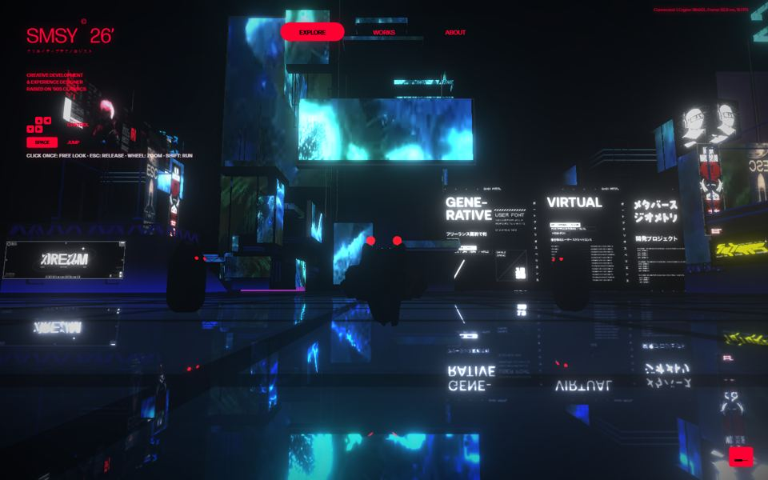
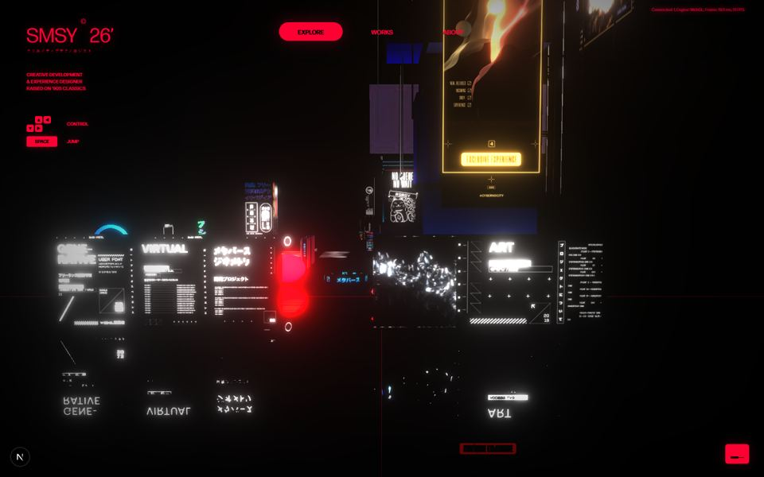
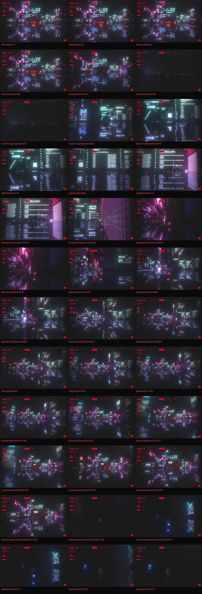

# Archived Kit City — Design Reference

> **What this is.** A full design record of the kit-instanced city (`cityRoot`)
> that is currently built every load, then hidden (`cityRoot.visible = false`)
> and stripped from collision inside `CyberCityCanvas.tsx`, while new
> hand-built, Blender-referenced buildings are designed from scratch. Nothing
> described here is deleted — per `progress.md`, "archived" means *paused*,
> not *finished with*. This document exists so the archived design can be
> **read back and recreated/restored** without re-deriving it from source
> again.
>
> **Companion docs.** `progress.md` (repo root) is the current single source
> of truth for *why* things are archived and what phase the project is in —
> if anything here conflicts with it, `progress.md` wins. `CyberCity.scene.spec.md`
> (this folder) covers the *live* reconstruction as a whole (camera, movement,
> avatar, renderer setup). This document is scoped specifically to the
> **archived kit city's visual design** — billboards, buildings, lighting, and
> the effects around them — at the level of detail needed to rebuild it.
>
> **Evidence.** Every exact number below was read directly from the live
> `src/components/samsy/CyberCityCanvas.tsx` (modified Aug 3, 21:19) and
> `src/data/samsy-world-layout.json` on Aug 4, 2026. Where prior recon docs
> (`docs/research/samsy/...REPORT.md`) describe the *original* `samsy.ninja`
> site's proprietary WebGPU behavior rather than this codebase, that is
> labeled "original site (recon)" to keep it distinct from "this codebase
> (verified)."

---

## 1. Quick-reference palette

| Element | Color | Notes |
|---|---|---|
| Night scene background / fog | `#17101c` | deep purple-black — `SCENE_BG_NIGHT` |
| Day scene background / fog | `#6a8fad` | dusty overcast blue — `SCENE_BG_DAY` |
| Hemisphere sky (night) | `#493f52` | muted mauve |
| Hemisphere ground (night) | `#020103` | near-black |
| Hemisphere sky (day) | `#a8bdd4` | pale blue |
| Hemisphere ground (day) | `#7a848e` | grey |
| Moonlight (night key light) | `#aec2ff` | cool blue |
| Moonlight (day, dimmed) | `#fff0d8` | warm cream |
| Sunlight (day key light) | `#fff2d6` | warm cream |
| Day ambient fill | `#dde6f0` | pale blue-white |
| Neon accent — red point light | `#ff003d` | hot red/pink |
| Neon accent — cyan point light | `#62c8ef` | cyan |
| Neon accent — magenta point light | `#ff3cbd` | magenta/pink |
| Bloom tint multiplier | `rgb(1.35, 0.72, 0.65)` | pushes all bloom warm/pink, never neutral white |
| Fallback-avatar eyes / halo | `#ff194a` | red |
| Floor "day" concrete albedo | `rgb(0.42, 0.44, 0.46)` | linear, only visible in day mode |

Dominant read in the reference screenshots (see §11): near-black base, cyan/teal
video-screen glow as the loudest color, white/red bilingual (EN/JP) signage
text, small saturated red/magenta point-light accents at ground level, and a
reflective floor that mirrors all of it upside-down.

---

## 2. How the archived city is built

Source: `CyberCityCanvas.tsx`, inside the `gltfLoader.load("/models/cyberfix.glb", ...)` callback.

1. **Asset.** `/models/cyberfix.glb` — 62 nodes / 38 meshes / 13 materials,
   ~47,145 vertices if rendered as unique geometry (from `CyberCity.scene.spec.md`).
   Each top-level child of the GLB scene is one **kit item** (a prefab: a
   building, a screen, a logo, etc.), keyed by name.
2. **Layout data.** `src/data/samsy-world-layout.json` maps each kit-item name
   to an array of `{position, rotation (Euler radians), scale, scriptData?}`
   transforms — one entry per instance placed in the world.
3. **`kitify` loop** (`CyberCityCanvas.tsx` ~L886–928): for every
   `[itemName, transforms]` pair, find the matching GLB child by name, and for
   every transform entry:
   - skip it if `scriptData.id === "about"` (defensive — see note below);
   - clone the source item's **direct children** (or the item itself if it has
     none), zero out *their* local position/rotation/scale, and group them;
   - apply the instance's position/rotation/scale to that group;
   - name the instance `${itemName}_instance_${n}` and add it to `cityRoot`.

   This discards whatever authoring-time transforms existed on the GLB nodes
   themselves — every building on screen is a bare geometry stamp positioned
   entirely by the JSON layout, not by anything baked into the GLB hierarchy.
4. `cityRoot.name = "smsy-original-instance-layout"`, added to `scene`,
   `updateMatrixWorld(true)`, then `new THREE.Box3().setFromObject(cityRoot)`
   derives `playableBounds` (inset by `WORLD_BOUNDARY_INSET = 1`).
5. **Then it is archived**: `cityRoot.visible = false`, and every mesh under
   it is removed from `collisionMeshes` / `groundMeshes` / `cameraCollisionSurfaces`.
   Because materials, screen shaders, and the main billboard are all set up
   **before** this step, archiving is purely a visibility + collision toggle —
   see §12 for exactly what to flip to bring it back.

Note on the `"about"` skip: no entry in the current `samsy-world-layout.json`
actually carries `scriptData.id === "about"`, so this filter is inert today —
all 35 defined instances get built. It's presumably a hook for an in-world
"About" trigger object from the original recon; worth knowing about if the
JSON is ever regenerated from a fresh extraction.

### 2.1 Kit inventory (17 types, 35 instances)

| Kit item | Count | X range | Y range | Z range | Scale range |
|---|---|---|---|---|---|
| `block_0` | 3 | −408.0 … 210.7 | 0.0 … 1.1 | −817.3 … 85.2 | 1.8 … 8.2× |
| `block_1` | 4 | −770.3 … 350.7 | 0.0 | −377.1 … 122.2 | 1.8 … 6.7× |
| `block_2` | 3 | −539.3 … 515.9 | 0.0 … 1.1 | −402.0 … 597.1 | 2.2 … 6.3× |
| `distributor_0` | 0 | — | — | — | *defined, unused in this layout* |
| `distributor_1` | 1 | 148.6 | 0.0 | −99.4 | 1.7× |
| `garbage` | 1 | 20.0 | 0.0 | 300.0 | 1.0× |
| `crossing_0` | 2 | −78.7 … 163.8 | 0.0 | −113.2 … −96.2 | 1.0× |
| `crossing_1` | 2 | −436.0 … −149.1 | 0.1 | −628.8 … −126.7 | 3.9 … 8.6× |
| `tower` | 2 | −110.8 … 137.0 | 0.0 | −183.6 … 3.0 | 1.6 … 2.3× |
| `map` | 2 | −617.4 … 152.3 | 0.0 | −731.1 … 213.1 | 42.5 … 73.9× |
| `barrier` | 2 | −190.5 … 187.9 | 0.0 … 76.7 | −20.9 … 32.8 | 5.0 … 14.4× |
| `wall_0` | 7 | −592.4 … 350.4 | −7.3 … 0.0 | −241.0 … 125.8 | 3.2 … 9.8× |
| `mac` | 1 | −108.3 | 79.5 | 3.2 | 1.8× |
| `buildingramp` | 2 | −71.6 … 157.8 | 0.0 | −72.3 … −11.6 | 1.5 … 2.3× |
| `samsy_logo` | 1 | 364.9 | 0.0 | 742.4 | 2.1× |
| `nintendo` | 1 | 340.0 | 0.0 | 300.0 | 1.0× |
| `notnyc_logo` | 1 | 237.6 | 109.9 | 130.4 | 4.8× |

Full per-instance rotation values live only in `src/data/samsy-world-layout.json`
(749 lines) — the table above is a derived summary, not a re-transcription, to
avoid copy errors on the 35 raw entries. Read that file directly for exact
figures on any single instance.

`map` is the extreme outlier at up to 73.9× scale — this is almost certainly
a large flat ground/terrain plane rather than a literal "map" prop, given the
name and the otherwise-tight scale range of everything else.

---

## 3. Billboards & signage

### 3.1 The animated "screen" material (the core billboard shader)

Any mesh whose **name contains "screen"** (`ANIMATED_SCREEN_NAME = /screen/i`,
matched in `toOriginalUnlitMaterial`) gets routed to
`createSourceScreenMaterial()` instead of the plain unlit surface material.
Base material: `MeshBasicMaterial`, `toneMapped: false`, `side: DoubleSide`,
carries over the source map/alphaMap/opacity/alphaTest, `depthWrite` off if
transparent. Behavior added via `onBeforeCompile`:

- **Glitch burst.** A per-pixel PCG hash seeded from
  `floor(worldZ + uScreenTime * 10.0)` fires a ~3.5% chance
  (`step(0.965, hash)`) RGB-channel-split burst each discrete time step (not
  continuous — it's a stepped/quantized trigger, which reads as a sudden
  glitch rather than a smooth wobble). During a burst, R/G/B are each
  re-sampled from the texture at slightly different UV offsets plus a
  sine-driven per-channel noise wobble, then a second "zoom" sample is
  blended in at 8%/5%/8% weight per channel, and each channel gets a flat
  `+0.05` floor. Net effect: a brief chromatic-aberration-like RGB tear.
- **Whole-panel flicker.** Independent of the glitch burst — a sine wave in
  world-Y and time (`17.5 rad/s`) smoothstepped into a `0.9–1.0` multiplier
  on the final color, i.e. a fast, small-amplitude flicker across the whole
  panel, not per-pixel noise.
- **UV tint.** `diffuseColor.rgb *= mix(vec3(1.0), vec3(vMapUv, 1.0), 0.9)` —
  a strong (90%) tint keyed directly to the panel's own UV coordinates. This
  is what gives screens their gradient/rainbow-ish color cast that's tied to
  position-on-panel rather than to the source texture's actual colors.
  Understanding this matters if you ever swap the source texture: **any**
  image put through this material will pick up the same UV-position tint.
- **Alpha.** Derived from `min(R+G+B, 1.0)`, discarded below `0.1`. Emissive
  output routes through fog like everything else in this unlit pipeline.
- Material cache key: `"smsy-source-screen-v6-panel-flicker"`.
- Every screen mesh is put on `BLOOM_SCENE_LAYER` (`= 1`) and pushed into
  `animatedScreenMaterials`, whose shared `uScreenTime` uniform is updated
  every frame to `elapsed` (seconds since start) in the render loop.

### 3.2 Rotating screens

A **subset** of screen meshes — those literally named `"screen_rotate"`
(`ROTATING_SCREEN_NAME = /screen_rotate/i`) — additionally spin. Each gets a
per-instance phase offset hashed (`pcgHash01`) from the sum of its parent
instance's `x + y + z` position, so instances don't rotate in sync. Per frame:
`screen.rotation.y = elapsed + phase` — i.e. **exactly 1 radian/second**
around world Y, not "approximately," with a randomized starting phase per
instance.

### 3.3 Live Main Billboard (the one thing *not* archived)

This is the one billboard-type object that stays visible even while
`cityRoot` is hidden — it's built by sampling geometry/texture *from* the
archived kit at load time, then added directly to `scene` (outside
`cityRoot`), so archiving the kit doesn't archive this.

Construction (`CyberCityCanvas.tsx` ~L1157–1210):

1. Traverse the (still-visible-at-this-point) `cityRoot` for the first mesh
   matching `ANIMATED_SCREEN_NAME` that has a `MeshBasicMaterial` with a
   `.map` texture.
2. Compute that mesh's geometry bounding box; sort its three dimensions
   descending; `kitScreenWidth = max(4, dims[0])`, `kitScreenHeight = max(4, dims[1])`
   (so width ≥ height by construction). Fallback defaults before a match is
   found: **8 × 12**.
3. Build a fresh `MeshStandardMaterial` wrapping that same map/alphaMap, then
   pass it through **the same** `createSourceScreenMaterial()` used for kit
   screens — the Main Billboard runs the identical shader described in §3.1.
4. Panel size: `panelW = min(14, kitScreenWidth * 1.35)`,
   `panelH = min(20, kitScreenHeight * 1.35)` — different caps on each axis,
   so which axis actually gets clamped depends on the sampled mesh's real
   proportions. (Exact final panel size isn't derivable from static source
   alone since it depends on the sampled GLB mesh's bounding box; read
   `renderer.domElement.dataset.customBillboardSize` at runtime for the exact
   live figure.)
5. `THREE.PlaneGeometry(panelW, panelH)`, name `"main-billboard"`,
   `rotation.y = π` (180°), `layers.enable(BLOOM_SCENE_LAYER)`.
6. **Position:** `(ORIGINAL_SPAWN.x, panelH * 0.5 + 0.4, ORIGINAL_SPAWN.z + 22)`
   → with the current live spawn (see §8), that's approximately
   **`(49.36, panelH/2 + 0.4, −262.76)`**.
7. Object name is deliberately `"main-billboard"` to match the Blender
   reference object `Main Billboard` in `reference.blend` by name.

If no kit screen mesh is found, the billboard is skipped entirely and
`dataset.customBillboard = "missing-kit-screen-source"` is set — worth
checking if the live billboard ever goes missing after a GLB change.

### 3.4 Archived video billboards

Two large video-textured planes exist, fully built, `visible = false`. Both
use `THREE.VideoTexture` (`SRGBColorSpace`, `LinearFilter` min/mag, no
mipmaps), a `DoubleSide` unlit `MeshBasicMaterial` (`toneMapped: false`), and
an underlying `<video>` element that is `loop = true`, `muted = true`,
`playsInline = true`, `autoplay = false` — currently never played.

| | Decorative / far-field | Works / near-spawn |
|---|---|---|
| Object name | `original-decorative-video-plane` | `persistent-works-video-plane` |
| Video source | `/videos/works/derivative.webm` | `/videos/works/akira.webm` |
| Base geometry | `PlaneGeometry(1, 1)` | `PlaneGeometry(1, 1, 5, 5)` |
| Scale | `(350·16/9, 350, 350)` ≈ `622.2 × 350` units | `(50·1.88, 50, 1)` = `94 × 50` units |
| Position | `(−550, 175, −350)` | `(47, 25, −10)` |
| Rotation | `Y = π/2` (90°) | `Y = π` (180°) |

The decorative plane is a huge, distant backdrop billboard (its 622-unit
width dwarfs everything else in the scene); the works plane sits close to
spawn at a human/building scale. Restoring either is a two-part job — see
§12, since visibility alone doesn't resume video playback.

### 3.5 Named signage instances

The five named (non-generic) kit items read as intentional, individually
placed signage/landmarks rather than repeated city fabric:

| Instance | Position (x, y, z) | Scale | Rotation | Note |
|---|---|---|---|---|
| `samsy_logo` | `(364.9, 0, 742.4)` | 2.10× | none | ground level, off in the +X+Z corner of the layout |
| `nintendo` | `(340, 0, 300)` | 1.00× | none | exact integer position/scale — reads as a hand-placed reference billboard, not procedurally derived |
| `notnyc_logo` | `(237.6, 109.9, 130.4)` | 4.82× | none | **elevated** — Y ≈ 110, mounted high (building-top height), not ground signage |
| `mac` | `(−108.3, 79.5, 3.2)` | 1.81× | none | also elevated, Y ≈ 79.5 |
| `tower` ×2 | `(137.0, 0, −183.6)` / `(−110.8, 0, 3.0)` | 1.58× / 2.30× | Y=180° / none | two towers, opposite rotations |

`notnyc_logo` and `mac` being mounted at height (rather than y=0 like
everything else) strongly suggests both are rooftop/high-facade signage —
worth keeping in mind if new custom buildings are meant to host equivalent
sign placements later.

---

## 4. Buildings & non-screen surfaces

Every kit mesh **not** matched by `ANIMATED_SCREEN_NAME` gets
`toOriginalUnlitMaterial()` instead (`CyberCityCanvas.tsx` ~L1058–1096):
`MeshBasicMaterial`, source map/alphaMap/color/opacity/alphaTest carried over,
`DoubleSide`, `toneMapped: false`, cached per source-material UUID. The one
behavior added on top, via `onBeforeCompile`:

```glsl
diffuseColor.rgb *= 0.3 * smoothstep(0.0, 20.0, vSurfaceWorldY);
```

Building/prop surfaces are **height-faded from black**: anything at world
`y = 0` renders fully dark (×0), ramping up to only **30% of texture
brightness** by `y = 20` and flat from there. There is no upper brightness —
buildings never get back to full texture brightness by this shader alone.
Combined with the very low hemisphere/moon light levels at night (§5), this
is *the* reason the archived city reads as dark silhouettes with only their
upper stories carrying any legible texture, and it's why screens/signage
(§3, unaffected by this darkening, run through bloom instead) are what
actually make the city legible in the dark. Material cache key:
`"smsy-source-surface-v5"`.

**Collision meshes:** any object with `"collision"` in its name is set
invisible, forced `DoubleSide`, and routed to `groundMeshes` (if also matching
`/ramp_collision/i`) or `collisionMeshes` + `cameraCollisionSurfaces`
otherwise — these are physics-only proxies, never rendered even when the kit
city is live.

---

## 5. Lighting rig

Six lights total, all defined once and re-tuned by `applyDayMode(enabled)`
rather than swapped out. Positions below are absolute world coordinates
(offsets are added to the live `ORIGINAL_SPAWN`, see §8).

| Light | Type | Night | Day | Position | Shadow |
|---|---|---|---|---|---|
| `hemiLight` | Hemisphere | sky `#493f52` / ground `#020103`, intensity `0.12` | sky `#a8bdd4` / ground `#7a848e`, intensity `0.45` | — | no |
| `moonLight` | Directional (key, night) | `#aec2ff`, intensity `0.55` | `#fff0d8`, intensity `0.15` (dims, doesn't turn off) | `spawn + (−140, 260, 110)`, target = spawn | yes — 2048² PCF soft, frustum ±180, bias −0.0015, normalBias 0.02 |
| `sunLight` | Directional (key, day) | intensity `0` (off) | intensity `0.85` | `spawn + (120, 320, −80)`, target = spawn | yes — 2048² PCF soft, frustum ±220 |
| `dayAmbient` | Ambient | intensity `0` | `#dde6f0`, intensity `0.28` | — | no |
| `redLight` | Point | `#ff003d`, intensity `0.24` | intensity `0.06` | `spawn + (0, 9, 5)` | no |
| `cyanLight` | Point | `#62c8ef`, intensity `0.12` | intensity `0.05` | `spawn + (−40, 28, 35)` | no |
| `magentaLight` | Point | `#ff3cbd`, intensity `0.16` | intensity `0.05` | `spawn + (45, 24, −55)` | no |

`redLight` distance/decay: `13 / 1.8`. `cyanLight` and `magentaLight`:
`55 / 2` each. All three neon accents stay *on* in day mode, just dialled
down to near-nothing (0.05–0.06) rather than switched off — they read as
night-only in practice but the code never fully zeroes them.

`applyDayMode` also drives, in the same call: scene background/fog color
(`#17101c` ↔ `#6a8fad`), fog near/far (`700/800` night → `80/1400` day — night
is deliberately much foggier/tighter than day), `renderer.toneMappingExposure`
(`1` → `1.05`), and the floor's `dayBoost` uniform (`0` → `0.7`, see §6).

Important: the reflective floor's shader is **fully unlit/custom** — none of
these six scene lights affect it. Its "lighting" is entirely the baked
reflection texture + bump/mask sampling described in §6. Scene lights
currently only affect the VRM player avatar and would light up new
standard-material buildings once added (per `progress.md`'s "Next" section).

---

## 6. Floor

A `Reflector`-based plane (`three/examples/jsm/objects/Reflector.js`) using a
fully custom shader (`originalMaskedReflectorShader`), not `Reflector`'s
default material.

- **Shape.** A `THREE.Shape` traced by eye off `reference.blend`'s `Floor`
  object (top-down/wireframe) — explicitly **not** vertex-exact. A road strip
  opening into a plaza with one chamfered corner, centered on `ORIGINAL_SPAWN`:
  - road half-width `10`, running from `spawn.z − 80` back to `spawn.z − 10`
    (where it opens into the plaza);
  - plaza spans `spawn.x ± 30`, from `spawn.z − 10` to `spawn.z + 32`;
  - one plaza corner chamfered by `15` units.
  - UVs are **manually remapped** to `(x + 12500) / 25000` (the old
    25,000-unit plane's world-space formula) rather than `ShapeGeometry`'s own
    bounding-box-normalized UVs, specifically to keep the shader's texture
    tiling density (below) unchanged after the shape shrank.
- **Reflector config.** `clipBias: 0.003`, texture size ≈ `0.75×` viewport ×
  DPR, base `color: 0x000000`, `position.y = −0.035`, `rotation.x = −90°`,
  enabled on `BLOOM_SCENE_LAYER`.
- **Shader.** Samples `bump-floor_fxrdig.jpg` twice — "macro" at `uv × 500`
  and "fine" at `uv × 2500` — a dual-scale tiling mask. Reflection UV gets
  perturbed by the macro sample (`(macro.yx*2-1) * 0.01`) for a subtle
  ripple/distortion on the mirror image. `reflectionMask = (1 − fine.g) ×
  min(1, 1 − macro.r)`.
  - **Night:** `reflectedScene × mask × vec3(uv, 1.0) × 0.78` — a dark, UV-tinted
    wet-look reflection.
  - **Day:** a flat concrete albedo `rgb(0.42, 0.44, 0.46)` blended by mask
    (`0.35–1.0` range) plus a much softer `× 0.22` reflection contribution, so
    looking straight down isn't pure black in daylight.
  - Blended by the `dayBoost` uniform (`0` night / `0.7` day — a partial mix,
    not a hard swap, "to keep the grid readable without washing out").

---

## 7. Atmosphere & post-processing

Renderer: WebGL2 where available, `alpha: false`, `antialias: true`,
`outputColorSpace = SRGBColorSpace`, **`toneMapping = THREE.NoToneMapping`**
(exposure `1`, `1.05` in day mode via `applyDayMode`) — tone mapping is done
manually in the composite shader below, not via Three's built-ins.
`shadowMap.type = PCFSoftShadowMap`.

**Selective bloom**, two composers:

1. `bloomComposer` — `RenderPass` + `UnrealBloomPass(strength 0.34, radius 0.27, threshold 0)`,
   rendered to a texture (`renderToScreen = false`). Before this pass, every
   mesh **not** on `BLOOM_SCENE_LAYER` gets its material swapped to a black,
   non-emissive "occluder" clone (`getBloomOccluderMaterial` — zeroes
   color/emissive, strips the map unless the material needs alpha for
   cutout shapes) so only screens, the reflective floor, and a few emissive
   details (avatar face, NPC badge, fallback-avatar eyes/halo) actually
   contribute to the blur.
2. `finalComposer` — base `RenderPass` + a custom `ShaderPass` that composites
   the two:
   - Screen-blend: `composited = 1 − (1 − scene) × (1 − bloom × 0.9 × tint)`,
     `tint = rgb(1.35, 0.72, 0.65)` — bloom is never neutral; it's pushed warm
     and pink/amber, boosting red and cutting blue.
   - **Horizontal-only** vignette (`smoothstep` on `vUv.x` both edges, width
     `0.33`) — no vertical vignette component.
   - A tiny highlight-preserving lift: `+= (1 − luminance) × 0.0104`.
   - Scanlines: `sin(uv.y × freq) × 0.005`, `freq = 3200 × (height / 1080)` —
     scales with output resolution so line density looks consistent across
     screen sizes.
   - A manual filmic-style grade: convert to sRGB, remap through a per-channel
     black-point/white-point/gamma curve (`blackPoint = (−0.35, −0.157, −0.266)`,
     `whitePoint = (0.778, 0.896, 0.906)`, `gamma = (2.53, 1.67, 1.91)` for
     R/G/B respectively), convert back to linear. The asymmetric per-channel
     gamma is what gives the render its teal/magenta-leaning contrast curve
     rather than a neutral filmic tone curve.

The reflection texture is captured **once per frame** during the bloom pass
and reused (not recaptured) for the final pass, specifically to avoid a
ghosted/duplicate reflection trail when the camera moves (documented inline
in the source as a fix for a previous bug — worth preserving if this pipeline
is ever rebuilt).

**DOM-level layer** (`SamsyExperience.tsx`): a `.samsy-vignette` and
`.samsy-scanlines` CSS overlay sit on top of the canvas in the DOM,
independent of and in addition to the WebGL vignette/scanline math above —
the "CRT" feel is reinforced at two separate layers.

---

## 8. Spawn point

```
ORIGINAL_SPAWN = (49.36, 0, −284.76)   // from markers.txt M1, live in code
PLAYER_SPAWN   = (49.36, 0, −329.76)   // ORIGINAL_SPAWN pulled back 45 units
                                        // into the middle of the road strip
```

The road/plaza floor shape, all six lights, and the Main Billboard are all
positioned **relative to `ORIGINAL_SPAWN`**, so this single point recenters
the entire archived layout if it ever changes. `markers.txt` (repo root)
confirms `M1: 49.36 0.00 -284.76`, timestamped Aug 3 13:00 — matching the code
exactly.

⚠️ **Discrepancy to flag:** `progress.md`'s "Spawn point" section currently
states `ORIGINAL_SPAWN = (46.23, 0, -225.65)`. That does not match either the
live source or `markers.txt`. The Main Billboard position **formula**
documented in `progress.md` (`(ORIGINAL_SPAWN.x, panelH/2+0.4, ORIGINAL_SPAWN.z+22)`)
is correct and matches code exactly — only the raw coordinate value quoted
there is stale. Worth a one-line fix in `progress.md` next time it's touched.

World bounds (`playableBounds`) are derived at runtime from
`Box3().setFromObject(cityRoot)` inset by 1 unit, so they aren't a fixed
constant — they follow directly from §2.1's instance data.

---

## 9. Other supporting design elements

Not part of `cityRoot`, but part of how the archived scene reads as a whole:

- **Fallback avatar** (shown only while the VRM loads): a dark capsule body
  (`0x0c0b10`, roughness 0.86) sized to match `owo7.vrm` (1.75m tall, 0.84m
  wide), with two glowing red (`#ff194a`) spherical eyes on `BLOOM_SCENE_LAYER`
  plus a matching small red `PointLight` "halo" per eye (intensity 0.09,
  distance 1.35).
- **NPCs.** Three dark floating proxy forms (per `CyberCity.scene.spec.md`)
  with a small emissive badge core (`#ffe9ed`, on `BLOOM_SCENE_LAYER`). Each
  frame they bob vertically (`sin(elapsed × 1.05 + index × 1.7) × 0.025`) and
  yaw smoothly to face the player.
- **Loading screen:** pulsing "eyes" motif, progress bar, label
  `"ENTERING CYBERCITY — {n}%"`.
- **Ambient audio:** `/audio/slugabedsky.opus`, looped, volume `0.18`, tied to
  the mute toggle rather than always-on.
- **Day/Night toggle:** top-left button, label flips `NIGHT` ↔ `DAY`.

---

## 10. Visual references

Stills pulled from `docs/design-references/` for this document — worth
opening at full resolution for exact color/composition checks.


*`docs/design-references/final/explore-desktop-preview.jpg` — the billboard
cluster and floor reflection in context: cyan/teal video screens dominate,
white EN/JP text panels, small red point-light accents at ground level, dark
humanoid NPC silhouettes.*


*`docs/design-references/clone-home-small.jpg` — the DOM interface layer
(not part of `cityRoot`, but the palette this document's neon accents are
tuned to match): red as the dominant accent, a gold-bordered highlight panel,
mirrored/glitched typography.*


*`docs/design-references/world-frames/original/contact-sheet.jpg` — 27 frames
across idle/forward/back/left/right/jump camera states; useful for checking
any single element (a billboard, a light) reads correctly from multiple
angles, not just head-on.*

Further raw frame sequences: `docs/design-references/billboards-buildings-v5/`,
`docs/design-references/lighting-billboards-v4/` (includes an `akira-frames/`
sequence of the works-video billboard specifically).

---

## 11. How to restore / recreate this

To bring the archived kit city back exactly as designed (as opposed to
building new custom geometry inspired by it):

1. **Un-hide + restore collision.** In `CyberCityCanvas.tsx`, find the
   `// ── Archive all kit-instanced city buildings/props ──` comment block
   (~L1235). Removing or guarding that block (the `cityRoot.visible = false`
   line plus the loop that strips archived meshes out of `collisionMeshes` /
   `groundMeshes` / `cameraCollisionSurfaces`) is sufficient on its own —
   materials, screen shaders, and collision registration all already happen
   *before* this block runs, so skipping it restores rendering **and**
   physics together.
2. **Decide on the Main Billboard.** It currently lives outside `cityRoot`
   specifically so it survives archiving. Once the kit city is un-hidden,
   either leave it as an extra duplicate signage element or remove the
   standalone `mainBillboard` block (~L1190–1210) if the kit's own screen
   meshes should be the only billboards again.
3. **Restore a video plane.** Two steps, not one — visibility alone won't
   resume playback:
   ```js
   decorativeVideoPlane.visible = true; // or worksVideoPlane
   decorativeVideo.play();              // or worksVideo.play()
   ```
   Both underlying `<video>` elements are already `muted = true`, so
   autoplay-on-play should not be blocked by browser policy.
4. **Re-check world bounds** after restoring — `playableBounds` is derived
   from `cityRoot`'s bounding box at build time, so nothing else needs manual
   recalculation.
5. **Sanity-check via `renderer.domElement.dataset`** — the canvas element
   carries live debug markers (`cityInstanceCount`, `sourceScreenMeshCount`,
   `sourceSurfaceMeshCount`, `playerCollisionMeshCount`,
   `customBillboard`, `customBillboardSize`, `lightMode`, etc.) that confirm
   what actually got built/restored without needing to eyeball the scene.

To recreate the *look* rather than literally restoring the archived objects
(e.g. designing new custom buildings that should feel consistent with this
kit city, per `progress.md`'s "Next" section): reuse the §3.1 screen shader
on any mesh named to include `"screen"`, keep new building materials on the
§4 height-fade treatment (or intentionally deviate now that standard
materials + real scene lights are back in play, per §5's closing note), and
keep new geometry within roughly the §2.1 scale/position envelope so it
reads at the same city scale.

---

## 12. Known gaps & discrepancies (stated plainly, not guessed past)

- **Spawn coordinate mismatch** — see §8. `progress.md` currently quotes a
  stale `ORIGINAL_SPAWN`; live code and `markers.txt` agree with each other
  and are treated as correct here.
- **Tone mapping mismatch** — `CyberCity.scene.spec.md` (§ "Canvas and
  renderer") states "ACES filmic tone mapping." The live renderer is
  configured with `THREE.NoToneMapping`; grading instead happens entirely in
  the manual composite shader described in §7. That scene spec doc appears to
  predate the current custom color-grade pass.
- **Floor shape is eyeballed**, not vertex-exact — traced by eye from
  Blender screenshots per `progress.md`; treat the §6 coordinates as accurate
  to the current code, not as ground-truth architecture.
- **Main Billboard exact pixel size is runtime-derived** — §3.3 gives the
  formula and fallback defaults, not a fixed final number, since it depends
  on whichever kit screen mesh's bounding box is sampled first at load. Read
  `dataset.customBillboardSize` at runtime for the live figure if an exact
  value is needed.
- **This document does not cover** the 2D DOM views (`AboutView`, `WorksView`,
  `InterfaceShell` — see `docs/research/components/`), movement/physics
  constants, or the VRM avatar/animation system — those are live, unarchived,
  and already specified elsewhere.
